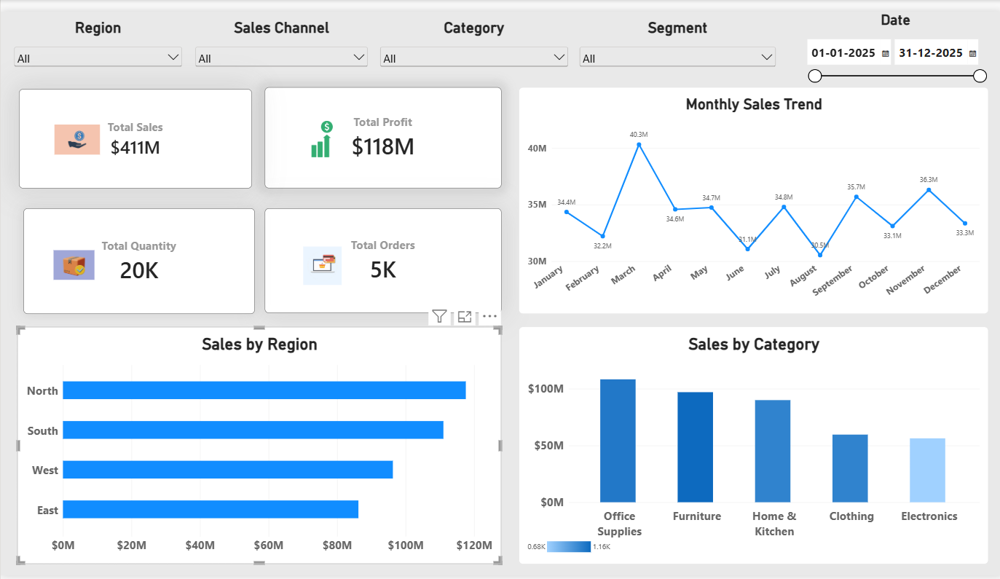
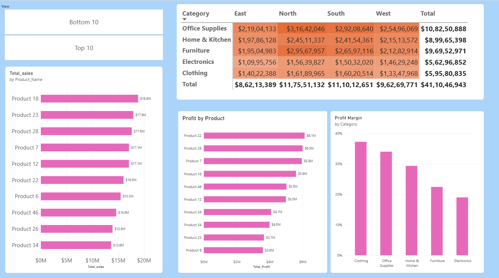
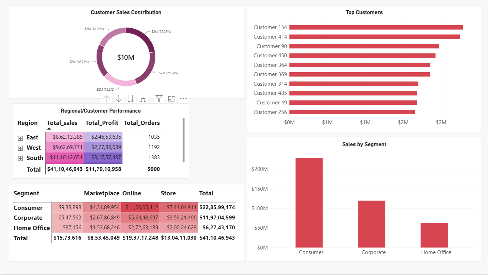

# Retail Sales Analytics

## Project Overview
This project analyzes retail sales, profitability, customer behavior, and regional performance using SQL, Python (Pandas), and Power BI.

## Tools Used
- **SQL (MySQL):** Business queries, aggregations, CTEs, and window functions
- **Python (Pandas):** Data inspection, cleaning, and preparation
- **Power BI:** Interactive dashboards and business reporting

## Business Questions
- Which products generate the highest sales and profit?
- Which categories have the strongest profit margins?
- Who are the top customers by sales?
- How do sales vary by month, region, and customer segment?
- How do sales channels perform across segments?
- How are discounts associated with sales and profitability?

## Dashboard Pages

### 1. Sales Overview

### 2. Product & Profitability Analysis

### 3. Customer & Business Analysis

## SQL Analysis
The project uses SQL aggregations, CTEs, and window functions to rank customers and products and compare product performance within categories.

## Data Cleaning
Pandas was used to inspect the dataset, check missing values and duplicates, and prepare date fields for analysis.

## Key Findings
Add 3–5 findings supported by your actual dashboard results. Include figures only after verifying them against your data.

## How to Use
1. Download or clone this repository.
2. Open the SQL files in MySQL Workbench.
3. Open the notebook in Jupyter Notebook or JupyterLab.
4. Open the Power BI `.pbix` file in Power BI Desktop.

## Author
Harsh Maurya
